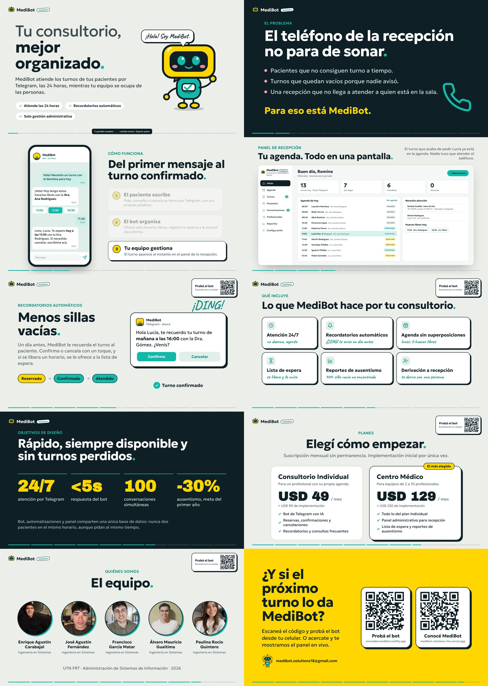

# MediBot · Loop para el stand

Presentación animada que se repite sola (unos 2 minutos por vuelta), pensada para un monitor en el stand de la muestra.

Los dos códigos QR (simulador y landing) quedan **siempre visibles** en la columna derecha, en todas las escenas.

Es **un solo archivo** (`index.html`) y funciona **sin internet**: las fuentes, las fotos y los QR están adentro del archivo.

## Cómo usarla en la notebook

1. Descargá `index.html`: abrilo en GitHub ([loop/index.html](index.html)) y tocá el botón **Download raw file** (ícono de descarga, arriba a la derecha del archivo).
   También podés bajar todo con **Code → Download ZIP**, pero en ese caso **descomprimilo** antes de abrirlo.
2. Abrí `index.html` con **Google Chrome** (doble clic o arrastrándolo a la ventana).
3. Apretá **F** (o doble clic) para pantalla completa. El mouse se oculta solo.
4. Antes de la muestra:
   - Desactivá la suspensión y el apagado de pantalla de la notebook (en Windows: *Configuración → Sistema → Inicio/apagado y suspensión → Nunca*).
   - Dejá la notebook enchufada.
   - Si usás el monitor como pantalla extendida, mové la ventana de Chrome al monitor antes de apretar F.

## Controles

| Tecla | Acción |
|---|---|
| `F` o doble clic | Pantalla completa |
| `→` / `←` | Escena siguiente / anterior |
| `Espacio` | Pausar / seguir |

## Escenas

1. Intro: "Tu consultorio, mejor organizado."
2. El problema: el teléfono de la recepción
3. Conversación con el bot en Telegram (se escribe sola)
4. El turno aparece en el panel de recepción
5. Recordatorio automático y confirmación
6. Funciones
7. Objetivos de diseño
8. Planes y precios
9. El equipo
10. Cierre: "¿Y si el próximo turno lo da MediBot?"

Los datos del panel y de los chats son ficticios, igual que en la demo de la landing.

## Cambiar textos

Todo está en `index.html`. Cada escena es un bloque `<section class="scene" ...>`; su duración en milisegundos está en `data-dur`.
